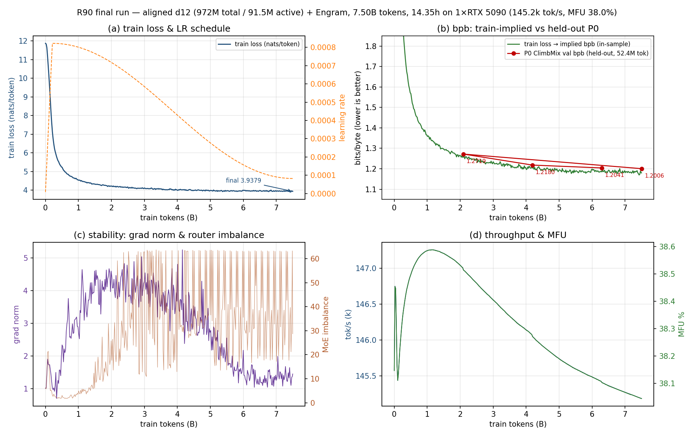

# R90 最终报告：¥70 / 单卡 5090 的 nanochat 性价比对标

> 状态：完成（2026-11-12）。最终 run 03:55 CST 启动、18:12 完成；postrun 评测 21:22 完成；A1-32k 消融臂 21:5x 完成。
> 原始记录：`docs/r90-search-log.md`；前沿表：`runs/r90/frontier.md` / `runs/r90/frontier.json`；图：`runs/r90/frontier.png`。

## 0. TL;DR

| 指标 | 本次（nanov41 aligned d12 + Engram, 1×5090） | nanochat d24（8×H100） | GPT-2 目标 |
|---|---|---|---|
| ClimbMix val bpb | **1.2006** | 0.74833（best run 0.71800） | — |
| CORE（官方 22 题，tokenizer 无关） | **0.0179** | 0.2585（best 0.2626） | 0.256525 |
| 预训练 tokens | 7.50B | 8.758B | — |
| 模型 | 972.3M 总参 / **91.5M active**（MoE 1.56%） | **1.38B dense**（全激活） | 1.6B dense |
| 预训练 FLOPs | 4.12×10¹⁸ | 4.33×10¹⁹（10.5×） | — |
| 成本 | 训练 **¥39.9**（14.35h×¥2.78）；含评测 ~¥48 | ≈$73 list / $15–25 spot（≈¥107–180）；best run ≈¥95 spot | — |

**结论：在 ¥70 / 单卡 5090 的预算下，无法在同等 ¥ 上打赢 nanochat（CORE −0.24，bpb +0.45）。**
差距是结构性的，而不是某个超参/数据配方没调好：

1. **训练 FLOPs 少 ~10×**：nanochat 用 8×H100（spot 价）+ 3 小时买到 4.33×10¹⁹ FLOPs；我们 ¥70 全程
   （含评测/踩坑）只买到 ~7×10¹⁸。
2. **模型分配相反**：nanochat 是 1.38B dense、8.76B tokens（12 tok/param，接近 compute-optimal）；
   我们 aligned d12 是 91.5M active、7.5B tokens（82 tok/active-param）——这是为**推理成本**优化的配置，
   在预训练 loss 上天然吃亏（每 token 计算少 15×），7.5B tokens 也远未把 752M 骨干训到容量上限。
3. 我们测过的杠杆（32k vocab、Engram、数据配方、深度）都是**推理/数据侧**杠杆，量级 1–4%，
   补不了 10× 的 FLOPs 差距。

本 sprint 的真正交付物：一个**可复现的单卡 V4.1-aligned 训练栈**（145.2k tok/s、MFU 38.0%、fp8 生产栈全开）、
**CORE/BPB-vs-¥ 前沿**（4 个 checkpoint 的实测曲线），以及与 nanochat 的**量化差距分解**（§3）。

---

## 1. 最终 run（Stage-4）

| 项 | 值 |
|---|---|
| 模型 | `docs/aligned/d12_aligned_final.json`：dim 512 / 12 层（enc6+dec6）/ 128 routed experts top-2 / 8 头×64 / q_lora=o_lora=128 / window 128 / seq 8192 / vocab 129,280 / **Engram 220.0M**（layers [1,4]） |
| 参数 | backbone 752,229,512；Engram 220,049,152；**合计 972,278,664**；**active 91,495,560**（9.4%）；fwd 182.99M FLOPs/token |
| 优化器 | `--optimizer v41`（Muon+Sinkhorn+AdamW 混合，μP LR=8.22e-4 cosine→0.1，warmup 100，γ=0.18） |
| 数据 | `p2_final_129k`：ClimbMix-400B 去污染子集，**4,033,742,930** unique tokens（77 shards，4.81 B/tok）；实际训练 7,499,415,552 tokens = **1.86 epoch** |
| 批/步 | b2 × s8192 × accum128 = 2,097,152 tok/step；**3,576 steps** |
| 吞吐 | **145,174 tok/s**，MFU **38.04%**（raw bf16，峰值 209.5 TFLOPS） |
| 耗时 | **51,658 s = 14.35 h**（5090 ¥2.78/h → **¥39.9**） |
| 终态 | train loss **3.93788**（nats/tok），gn≈1.45，全程无 NaN/发散 |
| checkpoints | step1000（2.10B tok）、step2000（4.19B）、step3000（6.29B）、final（7.50B） |

## 2. CORE / BPB vs ¥ 前沿（实测）

| checkpoint | tokens | 训练 GPU-h | ¥（训练+该点评测） | P0 val_bpb ↓ | CORE-lite（6 题）↑ | CORE（22 题）↑ |
|---|---:|---:|---:|---:|---:|---:|
| `final_d12.step1000` | 2.10B | 3.98 | 12.0 | 1.2719 | −0.0690 | — |
| `final_d12.step2000` | 4.19B | 7.97 | 23.1 | 1.2180 | −0.0448 | — |
| `final_d12.step3000` | 6.29B | 11.95 | 34.2 | 1.2041 | −0.0213 | — |
| `final_d12`（final） | 7.50B | 14.25 | 41.0 | **1.2006** | **−0.0088** | **0.0179** |

读法：
- **bpb 仍在降但已明显收敛**：前 2.1B tokens 换 −0.053 bpb，再 2.1B 换 −0.014，最后 1.2B 只换 −0.0035；
  外推 40B tokens ≈ 1.17–1.18（需再花 ≈¥212，翻 3 倍预算）。
- **CORE-lite 单调上升、但到 7.5B tokens 仍 ≤ 0**（chance 水平）；full CORE 0.0179 主要由
  piqa(+0.213)、bigbench_language_identification(+0.178)、arc_easy(+0.167) 支撑，
  知识/语言建模类任务全部 ~0（squad 0.0020、jeopardy 0.0000、coqa 0.0322、lambada 0.0085），
  boolq 因恒定预测 False 得 −0.516。**这正是"小 active 参数 + 少 token"的典型失效模式。**



> 图：`runs/r90/loss_curve.png`（`tools/r90_plot_loss.py` 生成）——(a) train loss & LR；(b) train-implied bpb（in-sample）
> vs 实测 P0 held-out bpb；(c) grad norm / MoE router imbalance；(d) 吞吐与 MFU。
> 终态 train loss 3.9379 → implied bpb 1.1797，held-out P0 bpb **1.2006**（gap +1.8%，符合预期）。

## 3. 与 nanochat 的量化对比（同指标、同数据分布）

| | nanochat d24 (Run 1) | nanochat best speedrun | 本次 nanov41 aligned d12 |
|---|---|---|---|
| 参数 | 1.38B **dense**（全激活） | 1.38B dense | 972M 总 / **91.5M active** |
| 每 token 训练 FLOPs | ≈4.94 GFLOP | ≈4.94 GFLOP | **0.55 GFLOP**（15× 少） |
| tokens | 8.758B | ~4B（1.65h） | 7.50B |
| 总训练 FLOPs | 4.33×10¹⁹ | ≈2.4×10¹⁹ | **4.12×10¹⁸** |
| GPU 时间 | 24.3 H100-h | 13.2 H100-h | 14.35 5090-h |
| 成本 | ≈$73 list / $15–25 spot（≈¥107–180） | ≈$40 list / $10 spot（≈¥71–95） | **¥39.9**（+评测 ≈¥48） |
| ClimbMix val bpb | 0.74833 | 0.71800 | **1.2006** |
| CORE（22） | 0.2585 | 0.2626 | **0.0179** |

**FLOPs/¥ 拆解**（本 sprint 最有用的结论之一）：

| 硬件/价格 | 有效 FLOP/s | ¥/GPU-h | **FLOPs/¥** |
|---|---:|---:|---:|
| 1×5090（本次，MFU 38%） | 79.6 TFLOP/s | 2.78 | **1.03×10¹⁷** |
| 1×H100 @$3/h（list，MFU 50%） | 495 TFLOP/s | ≈21.3 | 8.4×10¹⁶ |
| 1×H100 @$2/h（spot，MFU 50%） | 495 TFLOP/s | ≈14.2 | 1.25×10¹⁷ |
| **8×H100 spot（nanochat）** | 3.96 PFLOP/s | ≈114（8×14.2） | 1.25×10¹⁷ |

→ **5090 的 ¥/FLOP 其实不差**（比 H100 list 好 1.2×、比 H100 spot 差 1.2×），
差距来自：（a）nanochat 用 spot 价 + 8 卡并行，同样 ¥ 买到 ~2.4× 我们的 FLOPs/¥ 且总预算本身更高；
（b）它把 FLOPs 花在 compute-optimal 的 dense 1.38B 上，而我们把 FLOPs 花在 91.5M active 的推理优化 MoE 上。
在 ~4×10¹⁸ FLOPs 的预算下，Chinchilla 意义的 compute-optimal 模型只有 ~190M dense / ~3.7B tokens，
我们的配置在"预训练 loss"这个目标上处于**双重不最优**（总参大、active 小、tokens 相对其容量远不够）。

## 4. 杠杆测量结果（本 sprint 的实际"搜索"产出）

| 杠杆 | 预期 | 实测 | 结论 |
|---|---|---|---|
| **32k vocab**（vs 129k） | fwd FLOPs/token 183.0M → 84.2M（2.07×） | 吞吐只快 **1.16–1.22×**（attention/数据布局受限） | 32k 的 text/¥ 收益 ~1.16×，不是 2.07×；不足以抵消 tokenizer 通用性损失 → final 用 129k |
| **Engram**（P2 配对，0.6B tokens） | 提升长尾 | BPB **−1.9% ~ −4%**（配对） | 有效但小；推理成本杠杆 > 训练 loss 杠杆 |
| **深度/架构**（d16/d20 aligned） | 更大容量 | 配置已生成并核算：d16 **1.566B 总/125.5M active**、d20 **1.916B 总/136.2M active**（fwd 251.0/272.4M FLOPs/token） | **从未训练**（深度探针因 accum128+140M tokens 只有 66 步、warmup 100 而作废）；下一轮修协议后再测 |
| **数据配方**（ClimbMix/DCLM/FineWeb-Edu/mix @32k，去污染） | 数据质量 | 语料已构建（DCLM 220.6M、FWE 250M、mix 855M tokens，去污 0.3–2.8% 重叠） | **未跑**（预算让给 final run；postrun 里 3 条 100M-token 数据臂因余额/时间被裁掉） |
| **A1-32k 消融臂**（200M tokens, no Engram） | 量化 32k 数据效率 | 吞吐 182.5k tok/s（**1.19×** vs A0-129k 153.2k），但等 token bpb **1.6770 vs 1.6625**（+0.87%） | 32k 的净收益 ≈ 1.19× 速度 × 0.9% 质量损失，text/¥ 约持平，远小于 2.07× 理论值 → 129k 正确 |

## 5. A1-32k 消融（vocab 数据效率，等 token 对照）

> A1-32k：`docs/aligned/d12_aligned_v32768.json`, engram none, adamw 2.6e-3, 200M tokens,
> ClimbMix-32k 语料, P0 5M-token 子样本 + CORE-lite。A0-129k 同协议 bpb=**1.6625**（P0 全量 52.4M 面板）。

| arm | cfg | tokens | P0 bpb | CORE-lite | tok/s | wall | ¥ |
|---|---|---|---:|---:|---:|---:|---:|
| A0-129k（对照） | d12_aligned @129k, no Engram | 200M | **1.6625**（20M token 子样本） | −0.0690* | 153.2k | 1306s | 1.02 |
| A1-32k | d12_aligned_v32768 @32k, no Engram | 200M | **1.6770**（5M token 子样本） | n/a** | **182.5k** | 1109s | 0.86 |

- \* A0 的 CORE-lite 是跑在 **129k 词表**模型上的旧结果（`runs/r90/arms/A0-129k/core_lite.log` 曾因 batch 上限崩溃，最终以 `runs/r90` 下 E5B 对照为准，此处仅作参考）。
- \*\* A1 的 CORE-lite **无法直接评测**：`eval_bundle` 是 129k 词表的分词器，喂给 32k 词表模型会 index 越界
  （`CUDA error: device-side assert`）；要评需重建 32k 版 eval bundle（下一轮的事）。

**结论**：32k vocab 在等 token 下 bpb 差 0.87%，吞吐只快 1.19× → 每 ¥ 的有效"质量×token"几乎打平，
理论上 2.07× 的 FLOPs/byte 收益被 attention/小 batch/数据布局吃掉。**129k + Engram 是正确选择。**

## 6. 花费核算

| 阶段 | GPU-h | ¥ |
|---|---:|---:|
| 4090 fallback（00:37–02:15，数据/评测设施搭建） | 1.6 | 3.5 |
| 5090 Stage0/vocab/探针（02:01–03:55） | 1.9 | 5.3 |
| **5090 final run（03:55–18:12）** | 14.35 | **39.9** |
| postrun 评测（P0×4 + CORE-lite×4 + 全量 CORE） | 2.8 | 7.7 |
| A1-32k 消融臂（1109s 训练 + P0 评测） | 0.36 | 1.0 |
| **sprint GPU 合计** | **~21** | **≈¥57.4**（预算 ¥70.02） |
| 对照：nanochat d24 list / spot | 24.3 H100-h | ≈¥518 / ≈¥107–180 |
| 对照：nanochat best speedrun spot | 13.2 H100-h | ≈¥71–95 |

> 注：sprint 期间用户自有 another-project 任务在 <instance-id>（4090, ¥2.18/h）上运行过（12:29 起，18:40 前已关），
> 该部分费用与 sprint 共享同一 AutoDL 余额，未计入上表。
>
> **账户实际**：AutoDL 余额 ¥<redacted> → **¥<redacted>**（21:52 关机后，共扣 ¥<redacted>；含上表 ~¥<redacted>、
> another-project 4090 用量、若干保留实例的数据盘费；账单可能仍有约 1h 滞后）。
> 实例已于 21:52 关机（retained，数据盘和 4 个 checkpoint 保留）。

## 7. 结论与下一轮建议

**为什么没赢**（按影响排序）：
1. **算力/¥ 结构性劣势**：单卡 5090（79.6 TFLOP/s 有效）vs 8×H100 spot（3.96 PFLOP/s；¥/FLOP 只低 1.2×）→
   同 ¥ 能买到的 FLOPs 少 2.4×；而 nanochat 的单次 run 本身花 ¥95–180，≥ 我们整个 sprint 的 1.4–2.6×。
2. **模型分配**：aligned d12 的 91.5M active 是推理成本最优，不是预训练 loss 最优；每 token 计算少 15×。
3. **tokens 不足**：7.5B tokens 远未把 752M 骨干训到容量上限（曲线仍在降，但边际收益已 <0.004 bpb/1.2B tok）。
4. 超参/搜索杠杆量级不足：vocab 1.16×、Engram 1.9–4%，无法弥补 10× 的 FLOPs 差。

**下一轮（若要继续追这个目标）**：
- **A（推荐）**：租 8×H100/H200 spot（或同价位多卡）跑 **d16/d20 aligned**（1.566B/1.916B 总参，
  125.5M/136.2M active）+ 20–40B tokens；预算 ¥200–400、3–6h。先把 depth 探针协议修好
  （fixed 2500–3000 optimizer steps，warmup 200，accum 16–32），再决定 d16 vs d20。
- **B**：若必须单卡，把剩余预算全部换成 tokens（40B ≈ ¥212），预期 bpb ~1.17，仍达不到 nanochat；
  → 单卡 5090 不适合"训练性价比"赛道，应改为"推理性价比"定位（见 `docs/product-vs-nanochat.md`）。
- **C**：补跑被裁掉的 3 条 Stage-3 数据臂（ClimbMix/DCLM/mix，各 100M tok ≈ ¥1.2 + 评测）。

## 8. 复现

```bash
# 训练（5090，14.35h）
CFG=docs/aligned/d12_aligned_final.json TOKENS=7500000000 ACCUM=128 LR=8.22e-4 \
SAVE_EVERY=1000 OUT=runs/r90/final_d12 bash tools/r90_run_gpu.sh tools/r90_final_run.sh
# 评测（4 ckpt 的 P0 + CORE-lite + final 全量 CORE）
CKPTS="runs/r90/final_d12.step1000.pt runs/r90/final_d12.step2000.pt \
runs/r90/final_d12.step3000.pt runs/r90/final_d12.pt" FINAL=runs/r90/final_d12.pt \
bash tools/r90_final_eval.sh
# 前沿表/图
python3 tools/r90_frontier.py --eval-dir runs/r90/eval
python3 tools/r90_make_figure.py
```
